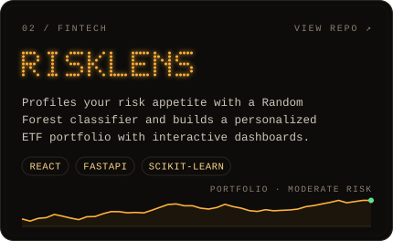

  Software Apprentice at Boeing &nbsp;·&nbsp; B.Tech CS + FinTech at MIT Manipal 
  I build full-stack products, data pipelines and developer tools.

  <a href="https://www.linkedin.com/in/arinjay-saxena-b33548286/">LinkedIn</a>
  &nbsp;/&nbsp;
  <a href="mailto:arinjay2112@gmail.com">Email</a>

 

 

  
  

Currently building open-source developer tools and contributing fixes upstream across the React, Java and Python ecosystems.

